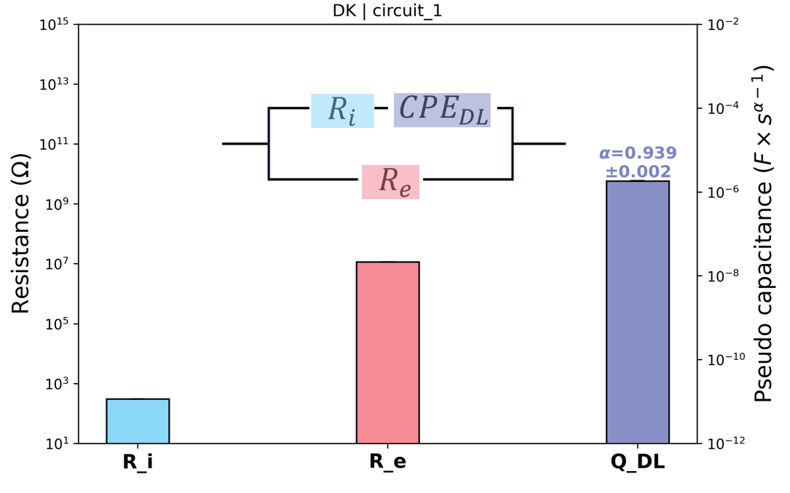
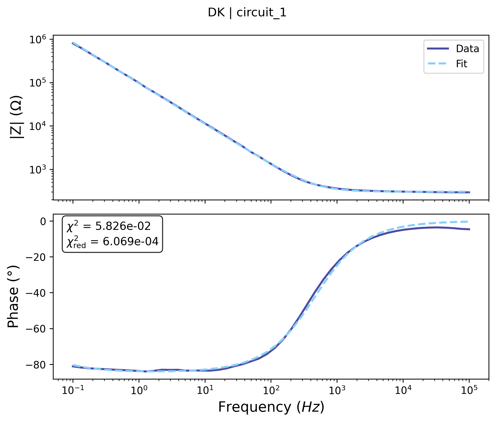
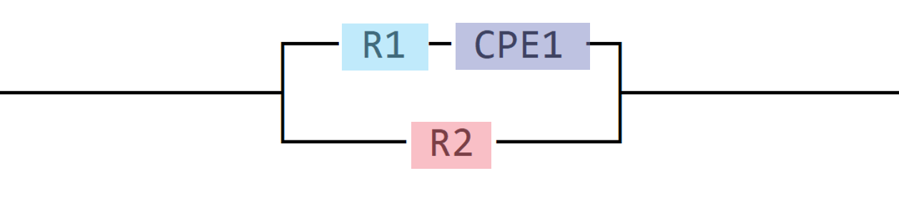

# EIS Fitting

Object-oriented Python workflow for preprocessing, fitting, analysing, and plotting electrochemical impedance spectroscopy (EIS) data from conductive hydrogel experiments.

The project was developed for automated fitting of conductive hydrogel impedance spectra but could be use with other materials given the proper equivalent circuits. It currently supports raw data preprocessing, equivalent-circuit fitting, fitted-parameter extraction, derived conductivity calculations, and generation of Bode, Nyquist, and parameter-summary plots.

---

## 1. Project overview

The workflow is organised around a small set of object-oriented components:

```text
main.py
    │
    ▼
EISPipeline
    │
    ├── EISPreprocessor
    │       ├── cleans raw EIS files
    │       ├── converts BioLogic .mpr files when needed
    │       ├── splits non-monotonic frequency sweeps
    │       └── creates pre-fitting Bode/Nyquist plots
    │
    ├── EISFitter
    │       ├── fits selected equivalent circuits
    │       ├── saves one fitted-parameter CSV per circuit
    │       ├── calculates chi-square and reduced chi-square
    │       └── creates fitted Bode and Nyquist plots
    │
    └── EISAnalyser / AnalysisPlotter
            ├── calculates derived quantities such as R_i conductivity
            ├── creates per-sample R/Q or R/C parameter bar charts
            └── creates experiment-level conductivity summary plots
```

The aim is to keep each class responsible for one task.

| Class | Role |
|---|---|
| `EISPipeline` | Coordinates the complete workflow. |
| `EISPreprocessor` | Converts, cleans, splits, and prepares raw EIS data. |
| `EISFitter` | Fits equivalent circuits and saves fitted parameters. |
| `FitPlotter` | Creates Bode and Nyquist plots of experimental vs fitted data. |
| `EISAnalyser` | Adds derived quantities, especially conductivity from `R_i`. |
| `AnalysisPlotter` | Creates parameter and conductivity bar charts. |
| `FigureSaver` | Saves figures according to user preferences, e.g. PNG, SVG, transparent background. |

---

## 2. Installation

Clone the repository:

```bash
git clone git@github.com:<your-username>/eis_fitting.git
cd eis_fitting
```

Create and activate a virtual environment:

```bash
python3 -m venv .venv
source .venv/bin/activate
```

Upgrade `pip`:

```bash
pip install --upgrade pip
```

Install the project dependencies:

```bash
pip install -r requirements.txt
```

If the package structure already supports editable installation, install it locally with:

```bash
pip install -e .
```

If not, run from the repository root so that the local imports work correctly.

---

## 3. Main dependencies

The main Python dependencies are:

```text
numpy
pandas
matplotlib
scipy
impedance
tqdm
galvani
seaborn
```

In order to install all of them in your virtual environment you can download the `requirements.txt` file in your directory and run :

```bash
pip install -r requirements.txt
```

---

## 4. Data organisation

The project is designed around a **data root** containing:

1. one `_methods/` folder containing reusable method files;
2. experiment folders organised by user/project/experiment.

Current architecture:

```text
data/
├── _methods/
│   └── conductive_hydrogel.json
│
└── <user>/<project>/<experiment>/
    ├── metadata.json
    ├── sample_1.csv
    ├── sample_2.csv
    └── ...
```

Example:

```text
data/
├── _methods/
│   └── conductive_hydrogel.json
│
└── Annabel/eis_flex/AB-01-001/
    ├── AB-01-001_01_01.csv
    ├── AB-01-001_01_02.csv
    └── metadata.json
```

The experiment folder should contain only:

- the experiment `metadata.json`;
- raw experimental files, such as `.csv`or `.mpr`.

It should not contain manually created fitting, analysis, or plotting folders. These are created automatically by the pipeline.

The `_methods/` folder stores reusable method-level settings, such as sample geometry and figure-saving preferences. This avoids repeating the same geometry and plotting settings in every experiment metadata file.

---

## 5. Local mode and workspace mode

The workflow can be used in two data-management modes.

### 5.1 Local mode

In local mode, processed files are written inside the experiment folder itself.

Example:

```text
data/
└── Annabel/eis_flex/AB-01-001/
    ├── AB-01-001_01_01.csv
    ├── AB-01-001_01_02.csv
    ├── metadata.json
    └── processed/
        ├── csv/
        └── fits/
            ├── AB-01-001_circuit_2.csv
            └── plots/
```

This mode keeps the raw and processed data together. It is simple and useful for small projects or quick testing.

### 5.2 Workspace mode

In workspace mode, raw data and processed data are separated.

The raw data stay in:

```text
data/<user>/<project>/<experiment>/
```

and the processed outputs are written to a separate workspace:

```text
workspace/processed/<user>/<project>/<experiment>/
```

Example:

```text
raw data:
data/Annabel/eis_flex/AB-01-001/

processed data:
workspace/processed/Annabel/eis_flex/AB-01-001/
```

The processed experiment folder then contains:

```text
workspace/processed/Annabel/eis_flex/AB-01-001/
├── csv/
│   ├── AB-01-001_01_01.csv
│   └── AB-01-001_01_02.csv
│
└── fits/
    ├── AB-01-001_circuit_2.csv
    └── plots/
        ├── AB-01-001_01_01/
        ├── AB-01-001_01_02/
        └── AB-01-001_circuit_2_Ri_conductivity_all_samples.png
```

Workspace mode is recommended for larger projects because the original raw data remain untouched and all generated files are stored separately.

---

## 6. Metadata and method files

The current architecture uses three JSON files:

1. a **global configuration file**
2. an **experiment metadata file**;
3. a reusable **method file** .

The experiment metadata file defines what should be run for a specific experiment.

The method file defines shared experimental settings, such as geometry and figure-saving preferences.

---

### 6.1 Experiment metadata file

Each experiment must contain a `metadata.json` file.

Example:

```json
{
    "method": "conductive_hydrogel",
    "description": "0.1 % w/v PEDOT:PSS, no Upy",
    "run": {
        "pre_plot": false,
        "plot": true
    },
    "circuits": [
        "circuit_2", "elec_1"
    ]
}
```

The `method` field points to a method file in:

```text
data/_methods/
```

For example:

```json
"method": "conductive_hydrogel"
```

loads:

```text
data/_methods/conductive_hydrogel.json
```

---

### 6.2 Experiment metadata fields

| Field | Meaning |
|---|---|
| `method` | Name of the method file to load from `data/_methods/`, without the `.json` extension. |
| `description` | Free-text description of the experiment. |
| `run.pre_plot` | If `true`, only preprocess and create preliminary plots. No fitting is performed. |
| `run.plot` | If `true`, generate plots. If fit CSVs already exist, plots can be regenerated without refitting. |
| `circuits` | List of circuit names to fit. These names must exist in the circuit dictionary. |

---

### 6.3 Method file

Method files are stored in:

```text
data/_methods/
```

Example:

```text
data/_methods/conductive_hydrogel.json
```

Example method file:

```json
{
    "geometry": {
        "thickness_cm": 0.1,
        "SD_thickness_cm": 0.01,
        "area_cm2": 1.0,
        "SD_area_cm2": 0.2
    },

    "save_preferences": {
        "transparent": false,
        "png": true,
        "svg": false
    }
}
```

---

### 6.4 Method file fields

| Field | Meaning |
|---|---|
| `geometry.thickness_cm` | Sample thickness in cm. |
| `geometry.SD_thickness_cm` | Standard deviation or uncertainty of thickness. |
| `geometry.area_cm2` | Electrode/sample area in cm². |
| `geometry.SD_area_cm2` | Standard deviation or uncertainty of area. |
| `save_preferences.transparent` | If `true`, figures are saved with a transparent background. |
| `save_preferences.png` | If `true`, figures are saved as PNG files. |
| `save_preferences.svg` | If `true`, figures are saved as SVG files. |

This separation makes experiments cleaner. The experiment metadata only describes the specific run, while the method file stores shared settings that can be reused across many experiments.

## 7. Running the workflow

The workflow is launched from `main.py`.

A typical `main.py` structure is:

```python
from pathlib import Path

from eis_fitting.circuits import CIRCUITS
from eis_fitting.pipeline import EISPipeline

PROJECT_ROOT = Path(__file__).resolve().parent.parent.parent
DATA_ROOT = PROJECT_ROOT / "data"

PERSON = "bel"
PROJECT = "shoebox"

OUTPUT_MODE = "workspace"
OUTPUT_ROOT = PROJECT_ROOT / "data_processed"


def main():
    # initialisation
    pipeline = EISPipeline(
        data_root=DATA_ROOT,
        circuits=CIRCUITS,
        output_mode=OUTPUT_MODE,
        output_root=OUTPUT_ROOT,
    )

    pipeline.run_project(person=PERSON, project=PROJECT, full_terminal=True)

```

Then run from ~/projects/eis_fitting :

```bash
python main.py
```

or, if the project is installed as a package run from ~/projects :

```bash
python -m eis_fitting.main
```

---

## 8. Pipeline behaviour

The run behaviour is controlled by the metadata file and by whether processed results already exist.

### 8.1 Preprocessing-only mode

If:

```json
"pre_plot": true
```

then the pipeline only preprocesses the data and generates preliminary plots.

Typical use:

```text
raw files
    ↓
cleaned CSVs
    ↓
pre-fit Bode/Nyquist plots
```

No equivalent-circuit fitting is performed.

This is useful for checking data quality before fitting.

### 8.2 Fitting mode

If:

```json
"pre_plot": false
```

and no fit results are available yet, the pipeline runs fitting and analysis.

Typical use:

```text
processed CSVs
    ↓
equivalent-circuit fitting
    ↓
fitted Bode/Nyquist plots
    ↓
parameter CSVs
    ↓
analysis plots
```

### 8.3 Fitting without plotting

If plotting is disabled in the current configuration, the fitter can be used to generate the csv file of fitted parameters without plotting.

```json
"plot": false
```

---

## 9. Output structure

A typical processed experiment has the following structure:

```text
processed/<person>/<project>/<experiment>/
├── csv/
│   ├── sample_1.csv
│   ├── sample_2.csv
│   └── ...
│
└── fits/
    ├── <experiment>_<circuit_1>.csv
    ├── <experiment>_<circuit_2>.csv
    └── plots/
        ├── sample_1/
        │   ├── circuit_1/
        │   │   ├── sample_1_circuit_1_bode_fit.png
        │   │   ├── sample_1_circuit_1_nyquist_fit.png
        │   │   └── sample_1_circuit_1_R_and_Q.png
        |   |
        │   └── circuit_2/
        │
        ├── sample_2/
        │
        ├── all_runs/
        │   └── combined plots, if enabled
        │
        ├── analysis/
        │   └── optional analysis-level plots
        │
        └── <experiment>_<circuit_1>_Ri_conductivity_all_samples.png
```

---

## 10. Equivalent circuits

Equivalent circuits are defined in the circuit dictionary, usually in a file such as:

```text
projects/eis_fitting/circuits.py
```

Each circuit entry contains:

- a circuit string
- initial guesses
- a mapping dictionary for readable parameter names, colours, and plotting order

Example:

```python
CIRCUITS = {
    "circuit_1": {
        "string": "p(R_1-CPE_1,R_2)",
        "guess": [
            100,
            1e-6,
            0.9,
            1000,
        ],
        "mapping": {
            "R_1": {
                "name": "R_i",
                "colour": "#80D4F8",
                "order": 0,
            },
            "R_2": {
                "name": "R_e",
                "colour": "#F37F8C",
                "order": 1,
            },
            "CPE_1_0": {
                "name": "Q_DL",
                "colour": "#7C84C2",
                "order": 0,
            },
            "CPE_1_1": {
                "name": "alpha_DL",
                "colour": "#7C84C2",
                "order": 0,
            },
        },
    },
}
```
 In this case, the equivalent circuit is as follows with an example of proper fitting.

<p align="center">
  
  
</p>

> Note that the names displayed in the parameter bars does not follow the `impedance.py` string naming convention but an intuitive mapping detailed in further sections.

### Circuit syntax

The circuit syntax follows the `impedance.py` `CustomCircuit` convention.

| Syntax | Meaning |
|---|---|
| `R_1-R_2` | Series connection. |
| `p(R_1,CPE_1)` | Parallel connection. |
| `CPE_1` | Constant phase element with two parameters: `CPE_1_0` and `CPE_1_1`. |

---

## 11. Fitting

For each selected circuit and each sample, the fitter:

1. reads the processed experimental EIS CSV
2. builds the complex impedance array
3. creates a `CustomCircuit`
4. fits the circuit using the supplied initial guesses
5. predicts the fitted impedance
6. extracts fitted parameters
7. calculates standard deviations and percentage errors where possible
8. calculates chi-square and reduced chi-square
9. saves the result to a circuit-specific CSV
10. generates fitted Bode and Nyquist plots if plotting is enabled

---

## 12. Fit-quality metrics

The fitter saves:

```text
chi_square
reduced_chi_square
```

The chi-square value quantifies the difference between experimental and fitted impedance values.

For complex EIS data, the residual contains both real (*Z'*) and imaginary (*Z''*) parts:

```text
Z = Z' + jZ''
```

The reduced chi-square is normalised by the degrees of freedom and is more useful when comparing circuits with different numbers of parameters.

However, chi-square and reduced chi-square are not used as the only criteria for model selection. Equivalent circuits must also be judged by:

- visual agreement in Nyquist and Bode plots
- absence of systematic residuals
- reasonable parameter values
- parameter uncertainty
- physical meaning of the circuit elements
- avoidance of unnecessary overfitting.

The fitted Bode and Nyquist plots can display both `chi_square` and `reduced_chi_square` directly on the figure.

---

## 13. Parameter CSV files

The fitter saves one CSV file per circuit:

```text
fits/<experiment>_<circuit_name>.csv
```

Each CSV should contain only the parameters relevant to that circuit.

For example, one circuit CSV may contain:

```text
sample
circuit_name
circuit_string
fit_success
fit_status
covariance_warning
chi_square
reduced_chi_square
R_i
SD_R_i
R_i_percent_error
Q_DL
SD_Q_DL
Q_DL_percent_error
alpha_DL
SD_alpha_DL
alpha_DL_percent_error
R_e
SD_R_E
R_e_percent_error
```

<p align="center">
  
</p>

Different circuits may have different columns, depending on the circuit elements.

> Small fitted values, especially CPE magnitudes, should be saved in scientific notation. The code should avoid rounding fitted parameters directly in `_fit_one`, because values such as `1e-9` can otherwise be rounded to `0.0`.

Recommended CSV saving format:

```python
df.to_csv(
    save_path,
    index=False,
    float_format="%.10e",
)
```

---

## 14. Conductivity calculation

The analyser calculates conductivity from the fitted resistance mapped as:

```text
R_i
```

The conductivity is calculated as:

```text
sigma = thickness / (R_i * area)
```

with:

```text
sigma  = conductivity in S.cm^-1
R_i    = ionic or bulk resistance in ohm
area   = electrode/sample area in cm^2
length = sample thickness in cm
```

The uncertainty is propagated from:

- thickness uncertainty
- area uncertainty
- resistance uncertainty

The analyser writes:

```text
conductivity_S_cm_R_i
SD_conductivity_S_cm_R_i
```

Only the resistance mapped as `R_i` is used for the main conductivity calculation, because this parameter is intended to represent the bulk or through-sample resistance of the hydrogel. Other fitted resistances, such as charge-transfer, transport, interfacial, or polarization resistances, should not automatically be converted into bulk conductivity.

These additional resistances are part of equivalent-circuit branches that represent distributed and coupled electrochemical phenomena rather than a simple homogeneous conduction path through the sample. Therefore, applying

$$
\sigma = \frac{L}{R A}
$$

to these resistances does not give a physically rigorous conductivity value.

However, such derived values can still be useful as qualitative indicators. While they should not be interpreted as absolute conductivities, they may help reveal overall trends between samples, such as increasing or decreasing resistance contributions associated with a specific fitted process.


---

## 15. Plotting

The workflow generates several types of plots.

### 15.1 Preliminary plots

Created during preprocessing when `pre_plot` is enabled.

Typical plots:

- raw Bode plot
- raw Nyquist plot
- split-frequency inspection plots

These are useful for identifying bad frequency ranges, outliers, or corrupted data before fitting.

### 15.2 Fitted Bode plots

For each sample and circuit:

```text
fits/plots/<sample>/<circuit>/<sample>_<circuit>_bode_fit.png
```

These show:

- experimental impedance magnitude and phase
- fitted circuit response
- chi-square and reduced chi-square, if available.

### 15.3 Fitted Nyquist plots

For each sample and circuit:

```text
fits/plots/<sample>/<circuit>/<sample>_<circuit>_nyquist_fit.png
```

These show:

- experimental complex impedance
- fitted complex impedance
- chi-square and reduced chi-square, if available.

### 15.4 Parameter bar charts

For each sample and circuit:

```text
fits/plots/<sample>/<circuit>/<sample>_<circuit>_R_and_Q.png
```

These show the fitted resistances and capacitance/CPE parameters for one sample.

The left y-axis is used for resistance values, and the right y-axis is used for CPE or capacitance values.

If the circuit contains CPEs, the alpha values can be written above the relevant bars.

### 15.5 Conductivity summary plots

For each circuit, the workflow creates one experiment-level conductivity plot:

```text
fits/plots/<experiment>_<circuit>_Ri_conductivity_all_samples.png
```

This plot contains:

- one bar per sample
- conductivity calculated from `R_i`
- optional error bars
- automatic y-axis scaling
- a colour gradient across samples.

The conductivity plot is saved directly in:

```text
fits/plots/
```

not inside the per-sample folders.

---

## 16. Plot customisation

Several plotting options can be modified from `main.py`, from metadata, or from a plotting-configuration dictionary depending on the current project setup.

### 16.1 Figure saving

Controlled by:

```json
"save_preferences": {
    "png": true,
    "svg": true,
    "transparent": true
}
```

Possible options:

| Option | Meaning |
|---|---|
| `png` | Save PNG figures. |
| `svg` | Save SVG figures. |
| `transparent` | Save figures with transparent backgrounds. |

### 16.2 Plotting limits

Manual y-axis limits can be supplied for bar charts.

Example:

```python
PLOTTING_LIMITS = {
    "R_and_Q": {
        "left_ylim": (1e0, 1e6),
        "right_ylim": (1e-10, 1e-2),
    },
    "conductivities": {
        "left_ylim": None,
    },
}
```

Then pass this to the pipeline or plotter:

```python
pipeline = EISPipeline(
    circuits=CIRCUITS,
    plotting_limits=PLOTTING_LIMITS,
)
```

If limits are set to `None`, Matplotlib automatic scaling is used.

For conductivity plots, automatic scaling is recommended because conductivities can vary significantly between experiments.

### 16.3 Conductivity bar width

The conductivity summary plot supports thinner or wider bars.

Example:

```python
bar_width = 0.35
```

A good publication-style range is:

```text
0.25 to 0.45
```

### 16.4 Conductivity colour gradient

The conductivity summary plot can use a Matplotlib colormap.

Examples:

```python
cmap_name = "viridis"
cmap_name = "Blues"
cmap_name = "plasma"
cmap_name = "magma"
cmap_name = "cividis"
```

For hydrogel conductivity plots, `viridis`, `Blues`, or `cividis` are recommended because they are clean and readable even for colourblind people.

### 16.5 Terminal output

The project can be run with a fuller terminal output mode if enabled in `main.py` or in the pipeline configuration.

Example:

```python
full_terminal = True
```

This is useful for debugging because it allows the workflow to print:

- selected experiment
- selected circuits
- preprocessing status
- fitting status
- failed fits
- covariance warnings
- skipped files
- saved output paths.

For large batch runs, a quieter mode can be used to reduce terminal output by calling `pipeline.run_project(person=PERSON, project=PROJECT, full_terminal=False)` in `main.py`

### 16.6 Progress bars

The fitting workflow can use `tqdm` progress bars to show fitting progress across samples and circuits.

This is useful for long experiments with many samples or several circuits

---

## 17. Fit warnings and failure handling

The fitter should track whether the fit was successful.

Useful output columns include:

```text
fit_success
fit_status
covariance_warning
error
```

A fit may be marked as failed if:

- the optimizer fails
- fitted parameters are not finite
- covariance cannot be estimated
- the fitted result contains unphysical values
- the circuit prediction fails
- the fit raises an exception

When covariance cannot be estimated, the result should be handled carefully because the fitted values may look reasonable while the uncertainty is not reliable.

---

## 18. Recommended workflow

### Step 1: Add raw data

Create an experiment folder:

```text
data/<person>/<project>/<experiment>/
```

Add:

```text
metadata.json
sample_1.csv
sample_2.csv
sample_3.mpr
```

### Step 2: Run preprocessing only

In `metadata.json`:

```json
"run": {
    "pre_plot": true,
    "plot": true
}
```

Run:

```bash
python main.py
```

Inspect the preliminary Bode and Nyquist plots.

### Step 3: Select circuits

Edit the `circuits` field in `metadata.json`:

```json
"circuits": [
    "ionic_2",
    "hydrogel_complex"
]
```

Make sure these names exist in the circuit dictionary.

### Step 4: Run fitting

Set:

```json
"run": {
    "pre_plot": false,
    "plot": true
}
```

Run:

```bash
python main.py
```

The workflow will fit the selected circuits and create fit plots.

### Step 5: Check the fit quality

Inspect:

- fitted Nyquist plots
- fitted Bode plots
- chi-square and reduced chi-square
- parameter uncertainties
- whether fitted parameters are physically meaningful

### Step 6: Inspect conductivity

Check:

```text
fits/plots/<experiment>_<circuit>_Ri_conductivity_all_samples.png
```

and the fitted parameter CSV:

```text
fits/<experiment>_<circuit>.csv
```

---

## 19. Common issues

### Missing parameter CSV

If the terminal prints:

```text
Skipping missing file: <path>
```

then the expected fit CSV does not exist.

Check that:

- the circuit name exists in `metadata.json`
- the circuit was successfully fitted
- the output folder is correct
- workspace/local mode points to the expected location

### CPE values appear as `0.0`

CPE magnitudes can be very small, for example:

```text
1e-8
1e-10
```

Do not round fitted values in `_fit_one`.

Avoid:

```python
row[key] = round(value, 6)
```

because this can turn small CPE values into `0.0`.

Use raw floats and save with scientific notation:

```python
df.to_csv(
    save_path,
    index=False,
    float_format="%.10e",
)
```

### Bar chart has invalid log scale

Log-scale plots cannot contain zero or negative values.

The plotting code should skip values that are:

```text
NaN
inf
0
negative
```

before passing them to Matplotlib.

### Covariance warning

If covariance cannot be estimated, fitted standard deviations and percentage errors are unreliable.

Such fits should be flagged with:

```text
covariance_warning = True
```

and treated cautiously.

---

## 21. Current development status

The current object-oriented version supports:

- local and workspace data modes
- metadata-driven experiment configuration
- preprocessing and pre-plotting
- multi-circuit fitting
- one fitted-parameter CSV per circuit
- circuit-specific parameter columns
- chi-square and reduced chi-square calculation
- fitted Bode and Nyquist plotting
- per-sample R/Q or R/C parameter plots
- R_i-based conductivity calculation
- experiment-level conductivity summary plots
- configurable plot limits
- configurable figure saving
- progress bars and terminal output options

This version is intended as a robust research workflow before packaging the project as a reusable Python library.