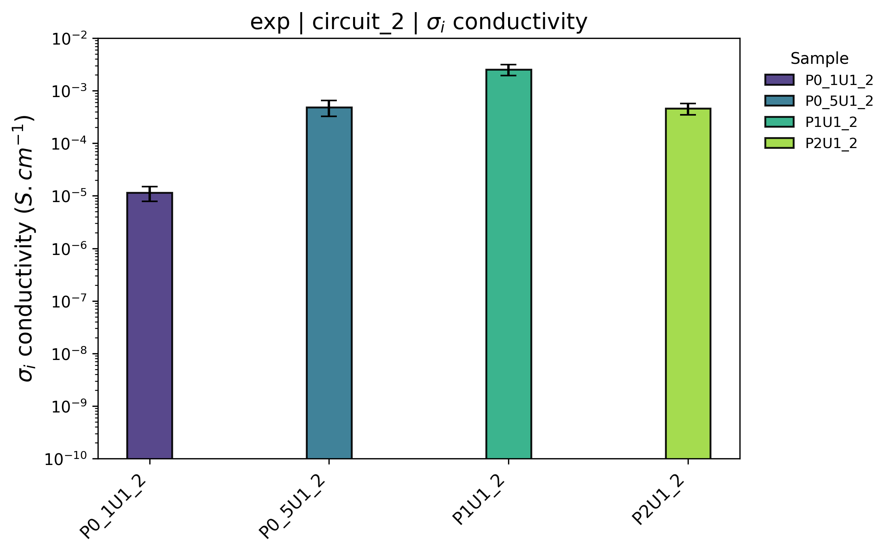

# EIS Fitting

Object-oriented Python workflow for preprocessing, fitting, analysing, and plotting electrochemical impedance spectroscopy (EIS) data from conductive hydrogel experiments.

The project was developed for automated fitting of conductive hydrogel impedance spectra but could be use with other materials given the proper equivalent circuits. It currently supports raw data preprocessing, equivalent-circuit fitting, fitted-parameter extraction, derived conductivity calculations, and generation of Bode, Nyquist, and parameter-summary plots.

---

## 1. Project overview

The workflow is organised around a small set of object-oriented components:

```text
main.py
    │
    ▼
global.json
    │
    ▼
EISPipeline
    │
    ├── ConfigLoader
    │       ├── reads the root-level global configuration
    │       ├── reads experiment-level metadata.json files
    │       ├── reads reusable method files from data/_methods/
    │       └── merges these settings into an Experiment object
    │
    ├── EISPreprocessor
    │       ├── cleans raw EIS files
    │       ├── converts BioLogic .mpr files when needed
    │       ├── splits frequency sweeps in distinct files
    │       └── can creates pre-fitting Bode/Nyquist plots for manual preprocessing
    │
    ├── EISFitter
    │       ├── fits selected equivalent circuits
    │       ├── saves one fitted-parameter CSV per circuit
    │       ├── calculates chi-square and reduced chi-square
    │       ├── calculates residuals and fitted-parameter uncertainties
    │       └── rejects non-identifiable fits when parameter error exceeds 100 %
    │
    └── EISAnalyser / EISPlotter
            ├── calculates derived quantities such as selected conductivities
            ├── creates per-sample R/Q or R/C parameter bar charts
            ├── creates residual plots when enabled
            └── creates one experiment-level summary plot per conductivity type
```

The aim is to keep each class responsible for one task.

| Class | Role |
|---|---|
| `EISPipeline` | Coordinates the complete workflow |
| `ConfigLoader` | Loads `global.json`, experiment `metadata.json`, and reusable method files |
| `Experiment` | Stores merged experiment settings, paths, selected circuits, geometry, and run options |
| `EISPreprocessor` | Converts, cleans, splits, and prepares raw EIS data |
|`PreprocessPlotter`| Plots Bode (phase and modulus) with visible points for manual removal of outliers |
| `EISFitter` | Fits equivalent circuits, calculates fit metrics, and saves fitted parameters |
| `FitMetrics` | Calculates residuals, chi-square, and reduced chi-square |
| `FitPlotter` | Creates Bode, Nyquist, and residual plots of experimental vs fitted data |
| `EISAnalyser` | Adds derived quantities, especially conductivities requested in the circuit mapping |
| `AnalysisPlotter` | Creates parameter and conductivity bar charts |
| `FigureSaver` | Saves figures according to global saving preferences, e.g. PNG, SVG, transparent background, dpi |

## 2. Installation

### Clone the repository:

```bash
git clone git@github.com:<your-username>/eis_fitting.git
cd eis_fitting
```

### Create and activate a virtual environment (recommended):

Using conda:

```bash
conda create -n eis_fitting python=3.11
conda activate eis_fitting
```

### Install dependencies

Upgrade `pip`:

```bash
pip install --upgrade pip
```

Install the project dependencies (`requirements.txt` can be deleted afterwards):

```bash
pip install -r requirements.txt
```

If the package structure already supports editable installation, install it locally with:

```bash
pip install -e .
```

If not, run from the repository root so that the local imports work correctly.

---

## 3. Data organisation

The project is designed around:

1. a root-level `global.json` file in the project repository;
2. one `_methods/` folder with the data, containing reusable method files;
3. experiment folders organised by user/project/experiment.

Current architecture:

```text
eis_fitting/
├── main.py
├── global.json
├── pipeline.py
├── circuits.py
|
├── config/
├── core/
├── preprocessing/
├── fitting/
├── analysis/
└── plotting/

data/
├── _methods/
│   └── conductive_hydrogel.json
│
└── <user>/<project>/<experiment>/
    ├── metadata.json
    ├── sample_1.csv
    ├── sample_2.csv
    └── ...
```

Example:

```text
data/
├── _methods/
│   └── conductive_hydrogel.json
│
└── Bel/eis_flex/AB-01-001/
    ├── AB-01-001_01_01.csv
    ├── AB-01-001_01_02.csv
    └── metadata.json
```

The experiment folder should contain only:

- the experiment `metadata.json`;
- raw experimental files, such as `.csv` or `.mpr`.

It should not contain manually created fitting, analysis, or plotting folders. These are created automatically by the pipeline.

The `_methods/` folder stores reusable method-level scientific settings, such as sample geometry and method-level frequency uncertainty. Figure-saving preferences are not stored in method files anymore; they are controlled globally from `global.json`.

## 4. Local mode and workspace mode

The workflow can be used in two data-management modes (see section `5.1 Global configuration file`).

### 4.1 Workspace mode (recommended)

In workspace mode, raw data and processed data are separated.

The raw data stay in:

```text
data/<user>/<project>/<experiment>/
```

and the processed outputs are written to a separate workspace:

```text
workspace/processed/<user>/<project>/<experiment>/
```

Example:

```text
raw data:
data/Bel/eis_flex/AB-01-001/

processed data:
workspace/processed/Bel/eis_flex/AB-01-001/
```

The processed experiment folder then contains:

```text
workspace/processed/Bel/eis_flex/AB-01-001/
├── csv/
│   ├── AB-01-001_01_01.csv
│   └── AB-01-001_01_02.csv
│
└── fits/
    ├── AB-01-001_circuit_2.csv
    └── plots/
        ├── AB-01-001_01_01/
        ├── AB-01-001_01_02/
        └── AB-01-001_circuit_2_Ri_conductivity_all_samples.png
```

Workspace mode is recommended for larger projects because the original raw data remain untouched and all generated files are stored separately.

### 4.2 Local mode

In local mode, processed files are written inside the experiment folder itself.

Example:

```text
data/
└── Bel/eis_flex/AB-01-001/
    ├── AB-01-001_01_01.csv
    ├── AB-01-001_01_02.csv
    ├── metadata.json
    └── processed/
        ├── csv/
        └── fits/
            ├── AB-01-001_circuit_2.csv
            └── plots/
```

This mode keeps the raw and processed data together. It is simple and useful for small projects or quick testing.

---

## 5. Metadata, method files, and global configuration

The current architecture uses three JSON layers:

1. a root-level **global configuration file**;
2. an experiment-level **metadata file**;
3. a reusable **method file**.

The separation is:

```text
global.json      → paths, run options, plotting options, save preferences
metadata.json    → experiment description, method name, selected circuits
_methods/*.json  → reusable scientific method settings, (only cell geometry for now)
```

This avoids repeating geometry and run options in every experiment folder.

---

### 5.1 Global configuration file

The root-level `global.json` file is placed next to `main.py`.

Example:

```json
{
    "paths": {
        "data_path": "/home/enzos/data/",
        "user": "enzo",
        "project": "test",
        "output_mode": "workspace",
        "output_path": "/home/enzos/data_processed"
    },
    "run": {
        "pre_plot": false,
        "fit": true,
        "plot": true,
        "plot_residuals": true,
        "display_chi_square": true,
        "fitting_frequency_range": null,
        "compute_mean_parameters" : true
    },
    "plotting_limits": {
        "R_and_Q": {
            "left_ylim": [
                1e-1,
                1e15
            ],
            "right_ylim": [
                1e-12,
                1e-2
            ]
        },
        "conductivities": {
            "left_ylim": [
                1e-10,
                1e-4
            ],
            "right_ylim": null
        }
    },
    "save_preferences": {
        "transparent": false,
        "png": true,
        "svg": false,
        "dpi": 250
    },
    "full_terminal": true
}
```

#### `paths`

| Field | Meaning |
|---|---|
| `paths.data_path` | Root folder containing the raw data and the `_methods/` folder |
| `paths.methods_path` | Folder containing reusable method files. If omitted, this can default to `<data_path>/_methods` |
| `paths.user` | User/person folder inside `data_path` |
| `paths.project` | Project folder inside `data_path/user` |
| `paths.output_mode` | Either `"local"` or `"workspace"` |
| `paths.output_path` | Root output folder used in workspace mode. Required if `output_mode` is `"workspace"` |

#### `run`

| Field | Meaning |
|---|---|
| `run.pre_plot` | If `true`, preprocess only and create preliminary plots. No fitting or analysis is performed afterwards |
| `run.fit` | If `true`, fitting is allowed when no fitted CSVs exist yet |
| `run.plot` | Master switch for plot generation. If `false`, the workflow can still fit and write CSV files without creating figures |
| `run.plot_residuals` | If `true`, residual plots are generated when fit plotting is enabled |
| `run.display_chi_square` | If `true`, fitted Bode/Nyquist plots display chi-square information |
| `run.fitting_frequency_range` | Frequency window used for fitting, in Hz. Use `null` to fit the full spectrum, or `[f_min, f_max]` to restrict the fit. One-sided ranges such as `[1, null]` or `[null, 100000]` are also supported |
| `run.compute_mean_parameters` | If `true`, appends one `MEAN` row to each circuit parameter CSV. The mean is computed over successful fits only. Parameter uncertainties are propagated from individual fitted standard deviations using $u(\bar{x}) = \sqrt{\sum_i u_i^2}/n$. Since $\chi^2$ and $\chi^2_{\mathrm{reduced}}$ do not have individual fitted uncertainties, their uncertainty is estimated from the sample-to-sample standard deviation across successful fits. |

#### `save_preferences`

| Field | Meaning |
|---|---|
| `save_preferences.transparent` | If `true`, figures are saved with a transparent background |
| `save_preferences.png` | If `true`, figures are saved as PNG files |
| `save_preferences.svg` | If `true`, figures are saved as SVG files |
| `save_preferences.dpi` | Resolution used when saving raster figures such as PNG. Defaults to `300` if not specified. Lower values speed up plotting and reduce file size; higher values are useful for publication-quality figures |

#### `plotting_limits`

Manual y-axis limits for analysis plots. Each entry corresponds to a figure type.

Example:

```json
"R_and_Q": {
    "left_ylim": [1e-1, 1e15],
    "right_ylim": [1e-12, 1e-2]
}
```

Use `null` to keep automatic Matplotlib scaling.

#### `full_terminal`

If `true`, the workflow prints more information about selected experiments, paths, skipped fits, failed fits, and generated outputs.

---

### 5.2 Experiment metadata file

Each experiment must contain a `metadata.json` file.

Example:

```json
{
    "method": "conductive_hydrogel",
    "description": "0.1 % w/v PEDOT:PSS, no Upy",
    "circuits": [
        "ionic_1"
    ]
}
```

The `method` field points to a method file in:

```text
data/_methods/
```

For example:

```json
"method": "conductive_hydrogel"
```

loads:

```text
data/_methods/conductive_hydrogel.json
```

Run options such as `pre_plot`, `plot`, `plot_residuals`, and `display_chi_square` are not stored in each experiment metadata but are rather controlled globally from `global.json`.

| Field | Meaning |
|---|---|
| `method` | Name of the method file to load from `data/_methods/`, without the `.json` extension |
| `description` | Free-text description of the experiment |
| `circuits` | List of circuit names to fit. These names must exist in the circuit dictionary |

---

### 5.3 Method file

Method files are stored in:

```text
data/_methods/
```

Example:

```text
data/_methods/conductive_hydrogel.json
```

Example method file:

```json
{
    "geometry": {
        "thickness_cm": 0.1,
        "SD_thickness_cm": 0.01,
        "area_cm2": 1.0,
        "SD_area_cm2": 0.2
    },
}
```

| Field | Meaning |
|---|---|
| `geometry.thickness_cm` | Sample thickness in cm |
| `geometry.SD_thickness_cm` | Uncertainty of thickness measurement |
| `geometry.area_cm2` | Electrode/sample area in cm² |
| `geometry.SD_area_cm2` | Uncertainty over area measurement |

## 6. Running the workflow

### 6.1 `main.py` file

The workflow is launched from `main.py`. The current structure keeps `main.py` short, loading `global.json`, creating the pipeline, and running the project specified in the global configuration.

The person, project, input path, output mode, and output path are read from `global.json`, so they do not need to be edited directly in `main.py`.

The run behaviour (see following subsections) is controlled by `global.json` and by whether processed results already exist.

### 6.2 Preprocessing-only mode

If:

```json
"pre_plot": true
```

then the pipeline only preprocesses the data and generates preliminary plots.

Typical use:

```text
raw files
    ↓
cleaned CSVs
    ↓
pre-fit Bode/Nyquist plots
```

This mode is intended for manual inspection and cleaning. After checking the preliminary plots, the user can manually remove bad points from the cleaned CSV files before running the workflow without any more pre-plotting to proceed with the fitting.

### 6.3 Fitting mode

If:

```json
"pre_plot": false,
"fit": true
```

and no fit results are available yet, the pipeline runs fitting and analysis.

Typical use:

```text
processed CSVs
    ↓
equivalent-circuit fitting
    ↓
fit metrics and residuals
    ↓
parameter CSVs
    ↓
fitted Bode/Nyquist/residual plots
    ↓
analysis plots
```

### 6.4 Fitting without plotting

If plotting is disabled in `global.json`, the fitter can generate fitted-parameter CSV files without producing figures.

```json
"plot": false
```

This is useful for quick batch fitting or when only the numerical results are needed.

### 6.5 Re-plotting without refitting

If fit CSV files already exist, the pipeline does not need to refit the data. To regenerate plots without refitting, delete only the plot folder:

```bash
rm -rf <processed_experiment>/fits/plots
```

Then make sure plotting is enabled in `global.json`:

```json
"plot": true
```

and rerun the workflow.

The fitted parameter CSV files are kept, while the plotter can recreate the Bode, Nyquist, residual, and analysis plots with new plotting limits, saving format, dpi, ...

## 7. Output structure

A typical processed experiment has the following structure:

```text
processed/<person>/<project>/<experiment>/
├── csv/
│   ├── sample_1.csv
│   ├── sample_2.csv
│   └── ...
│
└── fits/
    ├── <experiment>_<circuit_1>.csv
    ├── <experiment>_<circuit_2>.csv
    └── plots/
        ├── sample_1/
        │   ├── circuit_1/
        │   │   ├── sample_1_circuit_1_bode_fit.png
        │   │   ├── sample_1_circuit_1_nyquist_fit.png
        │   │   ├── sample_1_circuit_1_residuals.png
        │   │   └── sample_1_circuit_1_R_and_Q.png
        │   |
        │   └── circuit_2/
        │
        ├── sample_2/
        │
        ├── all_runs/
        │   └── combined plots, if enabled
        │
        ├── analysis/
        │   └── optional analysis-level plots
        │
        ├── <experiment>_<circuit_1>_Ri_conductivity_all_samples.png
        └── <experiment>_<circuit_1>_Rbulk_conductivity_all_samples.png
```

If a fit is rejected because one or more parameter percentage errors exceed 100 %, the parameter CSV records the failure. In that case, no Bode, Nyquist, residual, or bar plots are generated for that failed fit. Depending on when the output folders are created, an empty plot folder may remain; this is expected and indicates that the fit was skipped after validation.

## 8. Equivalent circuits

Equivalent circuits are defined in the circuit dictionary, usually in a file such as:

```text
projects/eis_fitting/circuits.py
```

Each circuit entry contains:

- a circuit string in `impedance.py` syntax
- an initial guess for each component parameter to be used by the complex, non-linear, least squares fitting method
- a mapping dictionary for readable parameter names, colours, plotting order, and conductivity calculation

Example:

```python
CIRCUITS = {
    "circuit_1": {
        "string": "p(R_1-CPE_1,R_2)",
        "guess": [
            1000,  # R_1 = R_i
            1e-6,  # CPE_1_0 =Q_DL
            0.9,  # CPE_1_1 = alpha_DL
            1e7,  # R_2 = R_e
        ],
        "mapping": {
            "R_1": {
                "name": "R_i",
                "colour": "#80D4F8",
                "compute_conductivity": True,
                "order": 0,
            },
            "R_2": {
                "name": "R_e",
                "colour": "#F37F8C",
                "order": 1,
            },
            "CPE_1_0": {
                "name": "Q_DL",
                "colour": "#7C84C2",
                "order": 0,
            },
            "CPE_1_1": {
                "name": "alpha_DL",
                "colour": "#7C84C2",
                "order": 0,
            },
        },
    },
    ...
}
```

In this example, conductivities are computed only for `R_i` because it is the only resistance with:

```python
"compute_conductivity": True
```

Plotting examples :

<p align="center">
  
  
</p>

> Note that the names displayed in the parameter bars do not follow the `impedance.py` string naming convention directly. They use the readable names defined in the circuit mapping.

### Circuit syntax

The circuit syntax follows the `impedance.models.circuits.circuits.CustomCircuit` convention.

| Syntax | Meaning |
|---|---|
| `R_1-R_2` | Series connection |
| `p(R_1,CPE_1)` | Parallel connection |
| `CPE_1` | Constant phase element with two parameters: $Q$: `CPE_1_0` and $\alpha$: `CPE_1_1` from $Z_{CPE}=\frac{1}{Q(j\omega)^{\alpha}}$ |

### Mapping fields

| Field | Meaning |
|---|---|
| `name` | Readable parameter name written to the fitted parameter CSV. |
| `colour` | Colour used in parameter bar plots. |
| `order` | Plotting order for parameters of the same family. |
| `compute_conductivity` | Optional boolean. If `true`, conductivity is calculated from this resistance. |

The `compute_conductivity` field is only meaningful for resistance elements.

--- 

## 9. Fitting

For each selected circuit and each sample, the fitter:

1. reads the processed experimental EIS CSV
2. builds the complex impedance array
3. creates a `CustomCircuit`
4. fits the circuit using the supplied initial guesses (optionally restricting the data to `run.fitting_frequency_range`)
5. predicts the fitted impedance
6. extracts fitted parameters
7. calculates standard deviations and percentage errors where possible
8. calculates residuals, chi-square, and reduced chi-square through `fitting/fit_metrics.py`
9. rejects the fit if any fitted parameter has a percentage error above 100 %
10. saves the result to a circuit-specific CSV
11. generates fitted Bode, Nyquist, and residual plots if plotting is enabled and the fit passed validation

The 100 % parameter-error threshold is used to reject visually good but non-identifiable fits. A fit can have a good chi-square and scattered residuals while still having poorly determined parameters. In that situation, the equivalent circuit may reproduce the spectrum, but the individual elements should not be interpreted physically.

Rejected fits are stored in the CSV with:

```text
fit_success = False
error = Fit rejected: parameter uncertainty above 100 % for ...
```

and are not plotted.

--- 

## 10. Fit-quality metrics and residuals

The fitting workflow evaluates the quality of each equivalent-circuit fit using two complementary approaches:

1. numerical fit-quality metrics, mainly `chi_square` and `reduced_chi_square`;
2. residual plots, which show how the fitting error is distributed across frequency.

These metrics are useful for comparing fits, but they should not be interpreted as proof that a circuit is physically unique or correct.

### 10.1 Complex impedance and residuals

For each frequency point, the experimental impedance is complex:

$$
Z_{\mathrm{exp}} = Z_{\mathrm{exp}}' + jZ_{\mathrm{exp}}''
$$

and the fitted circuit predicts:

$$
Z_{\mathrm{fit}} = Z_{\mathrm{fit}}' + jZ_{\mathrm{fit}}''
$$

The residual is the difference between the experimental and fitted impedance:

$$
r = Z_{\mathrm{exp}} - Z_{\mathrm{fit}}
$$


Because EIS data are complex, the residual contains both a real and an imaginary contribution:

$$
r(\omega) =
r'(\omega)
+
jr''(\omega)
$$

The `fit_metrics.py` module centralises these calculations. It is responsible for computing:

* complex residuals;
* relative real residuals;
* relative imaginary residuals;
* absolute residuals;
* `chi_square`;
* `reduced_chi_square`.

### 10.2 Chi-square

The chi-square value, $\chi^2$, measures the overall discrepancy between the experimental impedance spectrum and the fitted circuit response.

Since impedance values can vary by several orders of magnitude across the frequency range, this project uses a relative chi-square by default. The squared difference between experimental and fitted impedance is normalized by the magnitude of the experimental impedance:

$$
\chi^2 =
\sum_{\omega}
\frac{
\left|Z_{\mathrm{exp}}(\omega) - Z_{\mathrm{fit}}(\omega)\right|^2
}{
\left|Z_{\mathrm{exp}}(\omega)\right|^2
}
$$

This normalization prevents high-impedance points from dominating the fit-quality metric.

This is also consistent with the fitting procedure used in `fitting/fitter.py`, where the circuit is fitted using modulus weighting:

```python
circuit.fit(freq, z, weight_by_modulus=True)
```

In practical terms:

* a lower `chi_square` means that the fitted curve is numerically closer to the experimental data;
* a higher `chi_square` means that the fitted curve deviates more strongly from the experimental data.

However, raw `chi_square` depends on the number of data points and the number of fitted parameters. For this reason, it is mainly useful when comparing fits with the same circuit and the same frequency range.

---

### 10.3 Reduced chi-square

The reduced chi-square, $\chi^2_{\mathrm{red}}$, normalizes $\chi^2$ by the number of degrees of freedom of the fit:

$$
\chi^2_{\mathrm{red}} =
\frac{\chi^2}{\nu}
$$

where $\nu$ is the number of degrees of freedom of the fit.

For complex EIS data, each frequency point contributes two fitted values:

* the real impedance, $Z'$;
* the imaginary impedance, $Z''$.

Therefore, if there are $N$ valid frequency points and $p$ fitted circuit parameters, the number of degrees of freedom is calculated as:

$$
\nu = 2N - p
$$

Thus:

$$
\chi^2_{\mathrm{red}} =
\frac{\chi^2}{2N - p}
$$

The reduced chi-square is more useful than raw chi-square when comparing candidate circuits with different numbers of fitted parameters. A more complex circuit can often reduce raw $\chi^2$ simply because it has more adjustable parameters. Dividing by the degrees of freedom partially accounts for this increase in model complexity.

In the workflow, `reduced_chi_square` is therefore the preferred numerical metric for comparing different circuit fits to the same dataset.

---

### 10.4 Residual plots

While `chi_square` and `reduced_chi_square` give a single numerical estimate of fit quality, residual plots show where and how the model fails across the frequency range.

Residual plots are generated when the following option is set in `global.json`:

```json
"plot_residuals": true
```

The residual plots show, across the whole frequency range, the relative deviation between the experimental and fitted impedance (normalized by the magnitude of the experimental impedance).

These values are expressed as percentages, making it easier to compare residuals across frequency ranges with very different impedance magnitudes.

A good residual plot should show points randomly scattered around zero, without a clear frequency-dependent  structure (it would otherwise point out systematic error in the fit).

<p align="center">
  
</p>

Systematic residual patterns are important warning signs. For example:

| Residual behaviour                              | Possible interpretation                                                                                     |
| ----------------------------------------------- | ----------------------------------------------------------------------------------------------------------- |
| Random scatter around zero                      | The circuit captures the main impedance response reasonably well.                                           |
| Wave-like or sinusoidal residuals               | The circuit is missing one or more frequency-dependent processes.                                           |
| Residuals mostly above or below zero            | The model is biased and systematically over- or underestimates the data.                                    |
| Large low-frequency residuals                   | Possible missing electrode polarization, diffusion, drift, or slow relaxation.                              |
| Large high-frequency residuals                  | Possible missing contact resistance, inductive artefact, cable effect, or high-frequency measurement error. |
| Small residuals but very large parameter errors | The fit may be numerically good but poorly identifiable.                                                    |

---

### 10.5 Displaying fit metrics on plots

The fitted Bode and Nyquist plots can display both `chi_square` and `reduced_chi_square` directly on the figure when the following option is set in `global.json`:

```json
"display_chi_square": true
```

This makes it easier to visually compare the fitted spectrum and the numerical fit quality at the same time.

---

### 10.6 How to interpret fit quality

A fit should not be judged from `chi_square` or `reduced_chi_square` alone.

In practice, the fit should be considered reliable only when the following conditions are reasonably satisfied:

* the Nyquist and Bode plots show good visual agreement between experimental and fitted data;
* `reduced_chi_square` is low compared with other candidate circuits;
* residuals are randomly distributed around zero;
* fitted parameters are physically reasonable;
* fitted parameter uncertainties are acceptable;
* no covariance warning is reported;
* the circuit elements have a meaningful physical interpretation;
* the same circuit gives consistent trends across related samples.

A fit with a low `reduced_chi_square` but structured residuals should be interpreted cautiously. This means the circuit reproduces the overall shape of the impedance spectrum but does not fully capture all frequency-dependent processes.

Similarly, a fit with a low `reduced_chi_square` but very large parameter standard deviations is considered poorly identifiable. In the current workflow, fits are rejected when any fitted parameter has a percentage error greater than 100 %.

Therefore, `chi_square`, `reduced_chi_square`, and residual plots should be used together. The numerical metrics quantify the total fitting error, while the residual plots reveal whether this error is randomly distributed or systematic. The final choice of equivalent circuit should also depend on the physical meaning and stability of the fitted parameters.


## 10. Fit-quality metrics and residuals

For each frequency point, the experimental impedance is complex:

$$
Z_{\mathrm{exp}} = Z_{\mathrm{exp}}' + jZ_{\mathrm{exp}}''
$$

and the fitted circuit predicts:

$$
Z_{\mathrm{fit}} = Z_{\mathrm{fit}}' + jZ_{\mathrm{fit}}''
$$

The residual is the difference between the experimental and fitted impedance:

$$
r = Z_{\mathrm{exp}} - Z_{\mathrm{fit}}
$$

Because EIS data are complex, the residual contains both a real and an imaginary contribution.

### 10.1 Chi-square

The $\chi^2$ measures the total squared difference between the experimental spectrum and the fitted spectrum impedance. Since impedance values can vary by several orders of magnitude across the frequency range, the difference between experimental and fitted complex impedance is normalized by the experimental complex impedance as follows : 

$$
\chi^2 =
\sum_{\omega}
\frac{
\left|Z_{\mathrm{exp}}(\omega) - Z_{\mathrm{fit}}(\omega)\right|^2
}{
\left|Z_{\mathrm{exp}}(\omega)\right|^2
}
$$

> Note that this is also more coherent with the way the fitting proceeds since in `fitting/fitter.py` the fitting process is *weighted by modulus* : circuit.fit(freq, z, weight_by_modulus=True) 

### 10.2 Reduced chi-square

The reduced chi-square, $\chi^2_{\mathrm{red}}$, normalizes $\chi^2$ by the number of degrees of freedom of the fit **$\nu$**:

$$
\chi^2_{\mathrm{red}} =
\frac{\chi^2}{\nu}
$$

For complex EIS data, each frequency point gives two fitted values: the real impedance $Z'$ and the imaginary impedance $Z''$. Therefore, if there are $N$ valid frequency points and $p$ fitted circuit parameters, the degrees of freedom are calculated as:

$$
\nu = 2N - p
$$

Thus:

$$
\chi^2_{\mathrm{red}} =
\frac{\chi^2}{2N - p}
$$

### Purpose of these values

The purpose of `chi_square` is to quantify the total discrepancy between the measured impedance spectrum and the fitted equivalent-circuit response. A lower value generally indicates a closer numerical fit.

The purpose of `reduced_chi_square` is to make this comparison fairer when circuits have different numbers of fitted parameters. A more complex circuit often gives a lower raw chi-square simply because it has more adjustable parameters. By dividing by the degrees of freedom, `reduced_chi_square` partially accounts for model complexity.

Therefore, `reduced_chi_square` is usually more useful than raw `chi_square` when comparing several candidate circuits fitted to the same data.

However, neither value should be used as the only criterion for selecting an equivalent circuit. A circuit can have a low chi-square while still being physically inappropriate or overfitted. For this reason, the project uses chi-square values together with:

* visual agreement in Nyquist and Bode plots;
* residual plots;
* parameter uncertainties;
* covariance warnings;
* physical meaning of the circuit elements;
* consistency of fitted trends across samples.

In practice, `chi_square` and `reduced_chi_square` are best understood as quantitative fit-quality indicators, not as proof that a fitted circuit is physically unique or correct.


The chi-square value quantifies the difference between experimental and fitted impedance values.

For complex EIS data, the residual contains both real (`Z'`) and imaginary (`Z''`) parts:

```text
Z = Z' + jZ''
```

The `fit_metrics.py` module centralises the fit-quality calculations. It is responsible for calculating:

- complex residuals;
- real residuals;
- imaginary residuals;
- chi-square;
- reduced chi-square.

The reduced chi-square is normalised by the degrees of freedom and is more useful when comparing circuits with different numbers of parameters.

Residual plots are generated when:

```json
"plot_residuals": true
```

in `global.json`.

A good residual plot should show points scattered around zero without systematic structure. Curved, frequency-dependent, or sign-biased residuals usually indicate that the circuit is missing a physical contribution or that the selected frequency range is problematic.

<p align="center">
  
</p>

However, chi-square and residuals are not used as the only criteria for model selection. Equivalent circuits must also be judged by:

- visual agreement in Nyquist and Bode plots
- absence of systematic residuals
- reasonable parameter values
- parameter uncertainty
- physical meaning of the circuit elements
- avoidance of unnecessary overfitting.

The fitted Bode and Nyquist plots can display both `chi_square` and `reduced_chi_square` directly on the figure when:

```json
"display_chi_square": true
```

is set in `global.json`.

A fit with low chi-square but very large parameter standard deviations is considered non-identifiable. The workflow therefore rejects fits when any parameter percentage error exceeds 100 %.

## 13. Parameter CSV files

The fitter saves one CSV file per circuit:

```text
fits/<experiment>_<circuit_name>.csv
```

Each CSV should contain only the parameters relevant to that circuit.

For example, one circuit CSV may contain:

```text
sample
circuit_name
circuit_string
fit_success
error
chi_square
reduced_chi_square
R_i
SD_R_i
R_i_percent_error
R_bulk
SD_R_bulk
R_bulk_percent_error
Q_bulk
SD_Q_bulk
Q_bulk_percent_error
alpha_bulk
SD_alpha_bulk
alpha_bulk_percent_error
Q_DL
SD_Q_DL
Q_DL_percent_error
alpha_DL
SD_alpha_DL
alpha_DL_percent_error
conductivity_S_cm_R_i
SD_conductivity_S_cm_R_i
conductivity_S_cm_R_bulk
SD_conductivity_S_cm_R_bulk`
f_min_fit_Hz
f_max_fit_Hz
n_fit_points
```

If `run.compute_mean_parameters` is enabled, the CSV contains an additional summary row:

```text
sample = MEAN
fit_status = mean_all_successful_samples
is_summary = True
n_mean_samples = <number of successful fits>

Different circuits may have different columns, depending on the circuit elements and on which resistances have `compute_conductivity=True`.

If a fit is rejected, the CSV row still records the sample, circuit, `fit_success=False`, the error message, and `NaN` fit metrics. This makes failed fits visible without silently dropping samples.

When a restricted fitting frequency range is used, the CSV records the actual frequency window used for each fit. This makes it possible to trace whether parameters were obtained from the full spectrum or from a selected frequency interval.

> Small fitted values, especially CPE magnitudes, should be saved in scientific notation. The code should avoid rounding fitted parameters directly in `_fit_one`, because values such as `1e-9` can otherwise be rounded to `0.0`.

Recommended CSV saving format:

```python
df.to_csv(
    save_path,
    index=False,
    float_format="%.10e",
)
```

## 14. Conductivity calculation

The analyser calculates conductivities from fitted resistances only when requested in the circuit mapping.

For a resistance entry in `circuits.py`:

```python
"R_1": {
    "name": "R_i",
    "colour": "#80D4F8",
    "order": 0,
    "compute_conductivity": True,
}
```

the analyser writes:

```text
conductivity_S_cm_R_i
SD_conductivity_S_cm_R_i
```

The conductivity is calculated as:

```text
sigma = thickness / (R * area)
```

with:

```text
sigma  = conductivity in S.cm^-1
R      = selected fitted resistance in ohm
area   = electrode/sample area in cm^2
length = sample thickness in cm
```

The uncertainty is propagated from:

- thickness uncertainty
- area uncertainty
- resistance uncertainty

The relative uncertainty is:

```text
SD_sigma / sigma =
sqrt[
    (SD_thickness / thickness)^2
  + (SD_R / R)^2
  + (SD_area / area)^2
]
```

Only resistances explicitly marked with:

```python
"compute_conductivity": True
```

are converted into conductivity columns. This is important because not all fitted resistances represent a through-sample transport path.

<p align="center">
  
</p>

For example:

| Resistance type | Usually compute conductivity? | Reason |
|---|---:|---|
| `R_i` | Yes | Intended to represent ionic through-sample resistance. |
| `R_bulk` | Yes, if physically assigned to bulk transport. | Bulk pathway across the sample geometry. |
| `R_e` | Maybe | Only if interpreted as a through-sample electronic pathway. |
| `R_c` | No | Contact resistance is not a bulk material resistance. |
| `R_ct` | No | Charge-transfer resistance is an interfacial kinetic parameter. |
| `R_s` | Usually no | Often includes solution, lead, or series contributions. |

The conductivity plots are generated directly from the conductivity columns present in the parameter CSV. Therefore, the analysis step decides which conductivities exist, and the plotting step simply plots them.

For each conductivity type, one separate experiment-level plot is created. For example:

```text
fits/plots/<experiment>_<circuit>_Ri_conductivity_all_samples.png
fits/plots/<experiment>_<circuit>_Rbulk_conductivity_all_samples.png
```

This avoids mixing physically different conductivity estimates in the same figure.

## 15. Plotting

The workflow generates several types of plots.

### 15.1 Preliminary plots

Created during preprocessing when `pre_plot` is enabled.

Typical plots:

- raw Bode plot
- raw Nyquist plot
- split-frequency inspection plots

These are useful for identifying bad frequency ranges, outliers, or corrupted data before fitting.

### 15.2 Fitted Bode plots

For each sample and circuit:

```text
fits/plots/<sample>/<circuit>/<sample>_<circuit>_bode_fit.png
```

These show:

- experimental impedance magnitude and phase
- fitted circuit response
- chi-square and reduced chi-square, if enabled in `global.json`.

### 15.3 Fitted Nyquist plots

For each sample and circuit:

```text
fits/plots/<sample>/<circuit>/<sample>_<circuit>_nyquist_fit.png
```

These show:

- experimental complex impedance
- fitted complex impedance
- chi-square and reduced chi-square, if enabled in `global.json`.

### 15.4 Residual plots

For each successful sample/circuit fit:

```text
fits/plots/<sample>/<circuit>/<sample>_<circuit>_residuals.png
```

These show the residuals between experimental and fitted impedance data.

Residuals are controlled by:

```json
"plot_residuals": true
```

in `global.json`.

Residual plots are useful because a fit can look good in Bode or Nyquist space while still showing systematic deviations in the residuals.

### 15.5 Parameter bar charts

For each successful sample and circuit:

```text
fits/plots/<sample>/<circuit>/<sample>_<circuit>_R_and_Q.png
```

These show the fitted resistances and capacitance/CPE parameters for one sample.

The left y-axis is used for resistance values, and the right y-axis is used for CPE or capacitance values.

If the circuit contains CPEs, the alpha values can be written above the relevant bars.

Fits rejected because of parameter percentage errors above 100 % are not plotted. This can leave an empty sample/circuit folder if the folder was created before the fit was rejected.

### 15.6 Conductivity summary plots

For each conductivity column present in the parameter CSV, the workflow creates one experiment-level conductivity plot.

Example:

```text
fits/plots/<experiment>_<circuit>_Ri_conductivity_all_samples.png
fits/plots/<experiment>_<circuit>_Rbulk_conductivity_all_samples.png
```

Each plot contains:

- one bar per sample
- one conductivity type only
- optional error bars
- automatic or user-defined y-axis scaling
- a colour gradient across samples for style.

The conductivity plots are saved directly in:

```text
fits/plots/
```

not inside the per-sample folders.

### 15.7 Replotting

If only the plots need to be regenerated, delete:

```text
fits/plots/
```

and rerun the workflow with:

```json
"plot": true
```

The fit CSVs are preserved, so the workflow can replot without refitting. This is useful after changing:

- plot limits;
- save preferences;
- residual display;
- chi-square display;
- figure formats;
- labels or colours.

## 16. Plot customisation

Most plotting options are controlled from the root-level `global.json`.

### 16.1 Figure saving

Controlled by:

```json
"save_preferences": {
        "transparent": false,
        "png": true,
        "svg": false,
        "dpi": 250
    }
```

Possible options:

| Option | Meaning |
|---|---|
| `png` | Save PNG figures. |
| `svg` | Save SVG figures. |
| `transparent` | Save figures with transparent backgrounds. |
| `dpi` | Resolution for raster exports such as PNG. Defaults to `300`. |

The `dpi` option is especially useful when balancing speed, file size, and figure quality. For quick testing, values such as `100` or `150` can make plotting faster. For reports or publications, `300` or higher is recommended.

### 16.2 Plotting limits

Manual y-axis limits can be supplied for bar charts.

Example:

```json
"plotting_limits": {
    "R_and_Q": {
        "left_ylim": [1e0, 1e6],
        "right_ylim": [1e-10, 1e-2]
    },
    "conductivities": {
        "left_ylim": null,
        "right_ylim": null
    }
}
```

If limits are set to `null`, Matplotlib automatic scaling is used.

For conductivity plots, automatic scaling is often recommended because conductivities can vary significantly between experiments.

### 16.3 Residual plotting

Residual plotting is controlled by:

```json
"plot_residuals": true
```

If disabled, the workflow still fits the data and can still generate Bode, Nyquist, and parameter plots.

### 16.4 Chi-square display

Chi-square display on fit plots is controlled by:

```json
"display_chi_square": true
```

If disabled, chi-square and reduced chi-square are still calculated and stored in the CSV, but they are not written directly on the figures.

### 16.5 Conductivity colour gradient

The conductivity summary plots can use a Matplotlib colormap.

Examples:

```python
cmap_name = "viridis"
cmap_name = "Blues"
cmap_name = "plasma"
cmap_name = "magma"
cmap_name = "cividis"
```

For hydrogel conductivity plots, `viridis`, `Blues`, or `cividis` are recommended because they are clean and readable.

Since each conductivity type is plotted as a separate figure, no legend is required for conductivity summary plots. The colour gradient is only used to visually separate samples.

### 16.6 Terminal output

Terminal output is controlled by:

```json
"full_terminal": true
```

This is useful for debugging because it allows the workflow to print:

- selected experiment
- selected circuits
- preprocessing status
- fitting status
- failed fits
- high parameter-error rejection
- skipped files
- saved output paths.

For large batch runs, a quieter mode can be used:

```json
"full_terminal": false
```

### 16.7 Progress bars

The fitting workflow can use `tqdm` progress bars to show progress across samples and circuits.

This is useful for long experiments with many samples or several circuits.

## 17. Fit warnings and failure handling

The fitter tracks whether the fit was successful.

Useful output columns include:

```text
fit_success
error
chi_square
reduced_chi_square
<parameter>
SD_<parameter>
<parameter>_percent_error
```

A fit may be marked as failed if:

- the optimizer fails
- fitted parameters are not finite
- covariance or standard errors are unavailable
- one or more fitted parameter percentage errors exceed 100 %
- the fitted result contains unphysical values
- the circuit prediction fails
- the fit raises an exception

The 100 % parameter-error rule is designed to catch non-identifiable fits. These are cases where the circuit reproduces the impedance spectrum, but one or more individual parameters are poorly determined.

For example:

```text
R_bulk_percent_error = 250 %
```

causes the fit to be rejected.

The CSV row then contains:

```text
fit_success = False
error = Fit rejected: parameter uncertainty above 100 % for R_bulk: 250.0 %
```

Rejected fits are not plotted. If a plot folder has already been created before the rejection is detected, the folder may remain empty. This is not a plotting bug; it indicates that the fit did not pass validation.

<p align="center">
  
</p>

When covariance cannot be estimated, the result should be handled carefully because the fitted values may look reasonable while the uncertainty is not reliable.

## 18. Recommended workflow

### Step 1: Add raw data

Create an experiment folder:

```text
data/<person>/<project>/<experiment>/
```

Add:

```text
metadata.json
sample_1.csv
sample_2.csv
sample_3.mpr
```

### Step 2: Select a method

In `metadata.json`:

```json
{
    "method": "conductive_hydrogel",
    "description": "short experiment description",
    "circuits": [
        "ionic_1"
    ]
}
```

Make sure the corresponding method file exists:

```text
data/_methods/conductive_hydrogel.json
```

### Step 3: Run preprocessing only

In `global.json`:

```json
"run": {
        "pre_plot": false,
        "fit": true,
        "plot": true,
        "plot_residuals": true,
        "display_chi_square": true,
        "fitting_frequency_range": null,
        "compute_mean_parameters" : true
}
```

Run:

```bash
python -m eis_fitting.main
```

Inspect the preliminary Bode and Nyquist plots.

### Step 4: Run fitting

After manual cleaning, set in `global.json`:

```json
"pre_plot": false
```

Run:

```bash
python -m eis_fitting.main
```

The workflow will fit the selected circuits and create fit plots.

### Step 5: Check the fit quality

Inspect:

- fitted Nyquist plots
- fitted Bode plots
- residual plots
- chi-square and reduced chi-square
- parameter uncertainties
- whether fitted parameters are physically meaningful
- whether any fits were rejected because parameter error exceeded 100 %

> If `run.compute_mean_parameters` is enabled, inspect the `MEAN` row in each circuit parameter CSV to compare experiment-level average fitted parameters.

### Step 6: Inspect conductivity

Check the fitted parameter CSV:

```text
fits/<experiment>_<circuit>.csv
```

and the conductivity summary plots:

```text
fits/plots/<experiment>_<circuit>_<resistance>_conductivity_all_samples.png
```

Only resistances with `compute_conductivity=True` in `circuits.py` generate conductivity columns and conductivity plots.

### Step 7: Replot without refitting

To regenerate figures after changing style or plotting limits, delete only:

```text
fits/plots/
```

Then rerun:

```bash
python -m eis_fitting.main
```

The workflow will preserve the existing fit CSVs and regenerate the plots.

## 19. Common issues

### Missing parameter CSV

If the terminal prints:

```text
Skipping missing file: <path>
```

then the expected fit CSV does not exist.

Check that:

- the circuit name exists in `metadata.json`
- the circuit was successfully fitted
- the output folder is correct
- workspace/local mode points to the expected location

### CPE values appear as `0.0`

CPE magnitudes can be very small, for example:

```text
1e-8
1e-10
```

Do not round fitted values in `_fit_one`.

Avoid:

```python
row[key] = round(value, 6)
```

because this can turn small CPE values into `0.0`.

Use raw floats and save with scientific notation:

```python
df.to_csv(
    save_path,
    index=False,
    float_format="%.10e",
)
```

### Bar chart has invalid log scale

Log-scale plots cannot contain zero or negative values.

The plotting code should skip values that are:

```text
NaN
inf
0
negative
```

before passing them to Matplotlib.

### Covariance warning

If covariance cannot be estimated, fitted standard deviations and percentage errors are unreliable.

Such fits should be flagged and treated cautiously.

### Fit rejected because parameter error exceeds 100 %

A visually good fit can still be rejected if one or more fitted parameters have a standard error larger than the fitted value.

This means the equivalent circuit can reproduce the spectrum, but the individual parameter is not reliably identifiable.

Check the `error` column in the fit CSV for a message such as:

```text
Fit rejected: parameter uncertainty above 100 % for R_bulk: 250.0 %
```

Rejected fits are not plotted.

### Empty plot folder

An empty plot folder usually means that the folder was created before the fit was rejected or skipped.

Check the corresponding fit CSV. If `fit_success` is `False`, no Bode, Nyquist, residual, or parameter bar plot is expected.

### Conductivity plot missing

A conductivity plot is only generated if the corresponding conductivity column exists in the parameter CSV.

Conductivity columns are created only for resistances with:

```python
"compute_conductivity": True
```

in the circuit mapping.

### Replotting does not update figures

Delete the plot folder:

```bash
rm -rf <processed_experiment>/fits/plots
```

then rerun with:

```json
"plot": true
```

Do not delete the fit CSV files unless you want to refit the data.

## 21. Current development status

The current object-oriented version supports:

- local and workspace data modes
- root-level `global.json` configuration
- metadata-driven experiment configuration
- reusable method files in `data/_methods/`
- preprocessing and pre-plotting
- multi-circuit fitting
- one fitted-parameter CSV per circuit
- circuit-specific parameter columns
- residual, chi-square, and reduced chi-square calculation through `fit_metrics.py`
- fitted Bode and Nyquist plotting
- optional residual plotting
- per-sample R/Q or R/C parameter plots
- mapping-controlled conductivity calculation through `compute_conductivity`
- one experiment-level conductivity summary plot per conductivity type
- configurable plot limits through `global.json`
- configurable figure saving through `global.json`
- replotting without refitting by deleting only `fits/plots/`
- rejection of non-identifiable fits when parameter percentage error exceeds 100 %
- progress bars and terminal output options
- optional computation of experiment-level mean fitted parameters per circuit
- propagated uncertainties for mean parameter rows

This version is intended as a robust research workflow before packaging the project as a reusable Python library.
