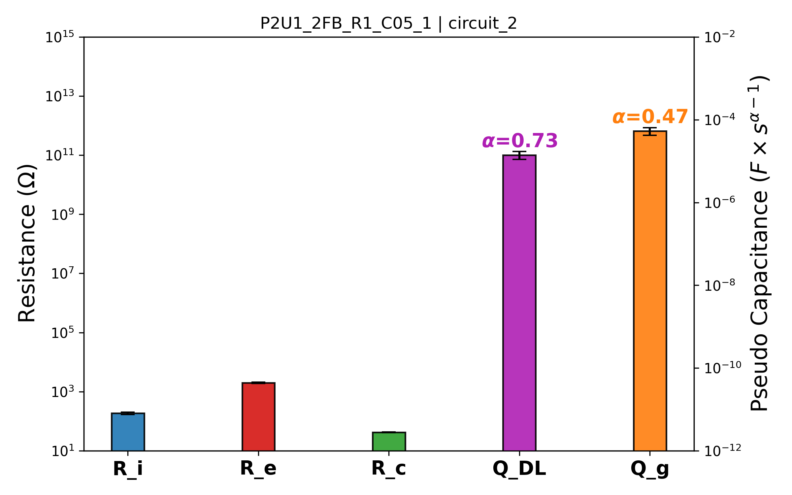
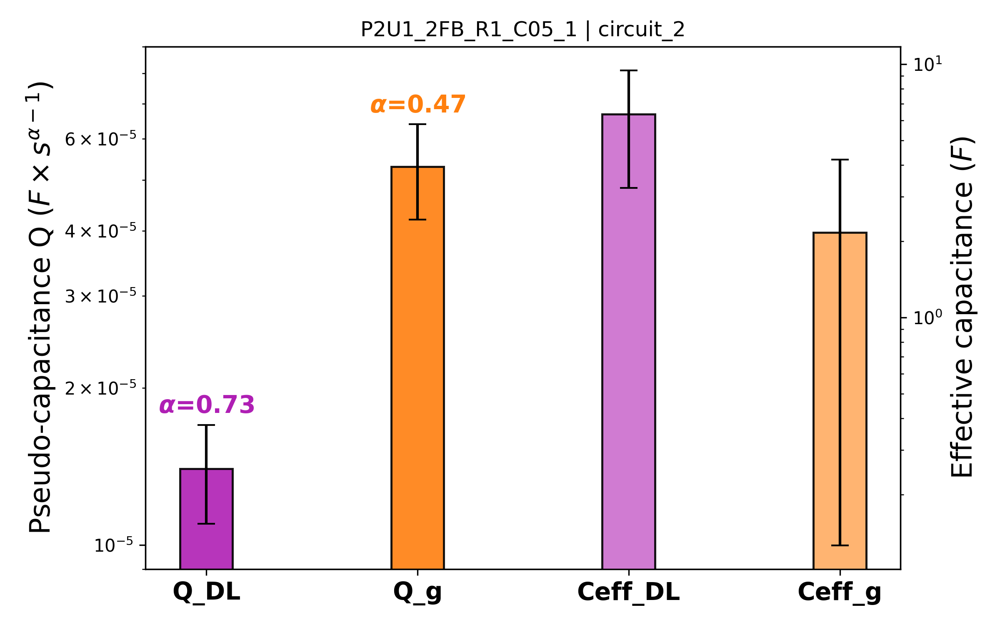

# EIS Analysis and Equivalent Circuit Fitting

Python workflow for processing, fitting, and visualising electrochemical impedance spectroscopy (EIS) data.

This repository provides tools for:

- Cleaning and restructuring raw EIS export files into unified CSV format
- Fitting impedance spectra to equivalent circuit models
- Extracting fitted circuit parameters and uncertainties
- Generating publication-ready Nyquist and Bode plots
- Batch processing multiple EIS datasets

---

# Features

## Raw EIS Data Processing

Currently supported input formats are:

- **Metrohm** CSV exports
- **BioLogic** `.mpr` files

The preprocessing functions (written in `./scripts/preprocess.py` and executed in `global.py`):

- Parse raw instrument MPR exports and convert them into CSV format
- Parse raw instrument CSV exports from Metrohm equipment
- Detect Bode phase, Bode magnitude, and Nyquist sections
- Standardise EIS column naming conventions
- Combine all measurements per experiment into a single structured CSV
- If need be, splits datasets into strictly monotonic frequency sweeps

Output format:

| freq/Hz | Phase(Z)/deg | \|Z\|/Ohm | Re(Z)/Ohm | -Im(Z)/Ohm |
|---|---|---|---|---|

---

## Equivalent Circuit Fitting

Supports fitting multiple equivalent circuit models using:

- `impedance.py`
- open-source Python package

Currently implemented models include:

### Circuit 1 : pseudo-Randles

> **p(R_1-CPE_1,R_2)**
```text
                ┌─ CPE1 ── R1 ─┐
────────────────┤              ├────────────
                └───── R2 ─────┘
```

### Interface + Bulk Model

> **R_1-p(R_3-CPE_1,CPE_2,R_2)**
```text
                 ┌─ R3 ─ CPE1 ┐
                 │            │
───── R1 ────────┼─── CPE2 ───┼─────────────
                 │            │
                 └──── R2 ────┘
```

Additional circuit models can be added through the `CIRCUITS` dictionary by respecting the following structure :

```json
{
    "circuit_1": {
        "string": "p(R_1-CPE_1,R_2)",
        "guess": [
            100,
            1e-6,
            0.9,
            1000,
        ],
        "mapping": {
            "R_1": {
                "name": "R_i",
                "colour": "#1f77b4",
                "order": 0,
            },
            "R_2": {
                "name": "R_e",
                "colour": "#d51613",
                "order": 1,
            },
            "CPE_1_0": {
                "name": "Q_DL",
                "colour": "#af1fb4",
                "order": 0,
            },
            "CPE_1_1": {
                "name": "alpha_DL",
                "colour": "#901994",
                "order": 0,
            },
        },
    },
}
```

> The `guess` key is used during the fitting method as a starting point and should thus be **carefully chosen**. We'll also note that these guesses ought to be given **in the same order as the components** in the `string` key and that two guesses are expected for a CPE : Q and n
> The `order` item provides the priority from left (0) to right when plotting elements of the same kind in the bar plots. Here, the following graph will be plotted for a  fit of circuit 2 :

<table>
  <tr>
    <td align="center">
      
    </td>
    <td align="center">
      
    </td>
  </tr>
</table>

---

## Plotting

Automatically generates:

### Nyquist plots

- Experimental data
- Circuit fit overlay
- Multi-sample comparison plots

### Bode plots

- Magnitude response
- Phase response
- Data vs fitted model

Plots are saved as PNG files.

---

## Analysis

After fitting, the script automatically analyses the fitted circuit parameters and augments the parameter tables with derived quantities.

### Conductivity

For each resistance element, the corresponding conductivity is calculated using the sample geometry:

```math
\sigma = \frac{L}{RA}
```

where:

- \(L\) is the sample thickness,
- \(A\) is the electrode area,
- \(R\) is the fitted resistance.

Uncertainties are propagated from the fitted resistance together with the supplied uncertainties in thickness and electrode area.

### Effective Capacitance

For each Constant Phase Element (CPE), an effective capacitance is calculated using the fitted pseudo-capacitance (\(Q\)), exponent (\(\alpha\)), and the characteristic angular frequency (\(\omega_{\max}\)):

```math
C_{\mathrm{eff}} = Q\omega_{\max}^{\,\alpha-1}
```

The uncertainty in the effective capacitance is propagated from the uncertainties in both \(Q\) and \(\alpha\), together with the user-specified uncertainty on the characteristic frequency.

### Parameter Tables

For every circuit, the analysis updates the parameter CSV with:

- Fitted parameter values
- Propagated standard deviations
- Percentage uncertainties
- Calculated conductivities
- Calculated effective capacitances

These tables provide a single location containing both fitted and derived electrochemical parameters.

### Bar Charts

If enabled in the metadata, publication-ready bar charts are generated for each fitted sample, including:

- Resistance and pseudo-capacitance
- Pseudo-capacitance and effective capacitance
- Conductivity

The plots feature:

- Consistent parameter ordering across circuits
- Colour-coded parameters defined by the circuit mapping
- Lighter colours for derived quantities
- Propagated error bars
- Automatic annotation of the CPE exponent (\(\alpha\)) above the corresponding pseudo-capacitance bars

This provides a rapid visual comparison of the electrochemical properties extracted from each equivalent circuit fit.

---

## Assumptions

The workflow assumes that:

- every dataset contains a valid `metadata.json` file;
- equivalent circuits follow the `impedance.py` syntax;
- frequency sweeps are monotonic (non-monotonic sweeps are automatically split into separate datasets before fitting);
- sample names do not contain full stops (`.`).

---
---

# Installation

## Clone the repository

```bash
git clone https://github.com/annabelbasford/eis_fitting.git
cd eis_fitting
```

---

## Create environment

Using conda:

```bash
conda create -n eis_fitting python=3.11
conda activate eis_fitting
```

---

## Install dependencies

```bash
pip install numpy pandas matplotlib seaborn impedance galvani
```

---

## Usage

### 1. Organise your data

Experiments are organised by **user**, **project**, and **experiment**.

```
data/
│
├── profiles/
│   ├── conductive_hydrogel.json
│   └── ...
│
└── <person>/
    └── <project>/
        └── <experiment>/
            ├── metadata.json
            └── raw/
                ├── sample_01.mpr
                ├── sample_02.mpr
                └── ...
```
> NB : mpr files can contain multiple frenquencies sweep in a raw thanks to the *split_non_monotonic_frequency_csv* in **scripts/eis_preprocess**
> ⚠️ sample's name **MUST NOT** contain full stops : instead of *"P2U1.2"* use *"P2U1_2"* otherwise everything after the full stop will be read as an extension and won't be processed.

---

### 2. Create a profile

Profiles contain the default configuration shared by a class of experiments, such as sample geometry, processing parameters and output preferences.

Example:

```json
{
    "geometry": {
        "thickness_cm": 0.10,
        "SD_thickness_cm": 0.01,
        "area_cm2": 1.00,
        "SD_area_cm2": 0.20
    },

    "save_preferences": {
        "transparent": false,
        "png": true,
        "svg": false
    }
}
```

---

### 3. Configure an experiment

Each experiment contains a `metadata.json` file that references a profile and specifies experiment-specific settings.

Example:

```json
{
    "profile": "conductive_hydrogel",

    "description": "PEDOT:PSS hydrogel with 10 wt% glycerol",

    "circuits": [
        "circuit_1"
    ]
}
```

Only settings that vary between experiments need to be stored here.

---

### 4. Select the project

In `global.py` (or your configuration script), specify the person and project to analyse:

```python
person = "enzo"
project = "EIS_hydrogels"
```

The pipeline will automatically search
_
```
data/enzo/EIS_hydrogels/
```

and process each experiment contained within that project.

> You can also use the `pre_plot` and `plot` parameters if you need to plot the bare Bode plots and remove outliers by hand for the first parameter, or to specify whether the script should plot the results or only giv the fitted parameters in *csv* files.

---

### 5. Run the pipeline

```bash
python global.py
```

Each experiment is processed independently, with results written to its own

- `processed/`
- `fits/`
- `plots/`

directories.

# Example Output

Outputs:

- Fitted parameter tables
- Confidence intervals
- Percentage fitting errors
- Nyquist plots
- Bode plots
- parameters bar charts

> NB : Effective capacitances are obtained from CPEs parameters using Hsu-Mansfeld's relation

---

## Summary CSV

| sample | circuit_name | R_1 | SD_R_1 | R_1_percent_error | CPE_1_0 | SD_CPE_1_0 | CPE_1_0_percent_error | CPE_1_1 | SD_CPE_1_1 | CPE_1_1_percent_error | R_2 | SD_R_2 | R_2_percent_error | ... |
| --- | --- | --- | --- | --- | --- | --- | --- | --- | --- | --- | --- | --- | --- | --- |

## Processed folder structure

```text
eis_fitting
├─── processed/ 
|    ├─── <person>/
│         ├─── <experiment>/                                      # see below for recommended naming conventions
│         |    ├─── csv/                                          # clean csv data
│         |    ├─── fits/                                        
│         |    │    ├─── plots/                                    
│         |    │    │    ├─── sample_1/                               
│         |    │    |    |    ├─── circuit 1                      # Bode, Nyquist and parameter bar charts
│         .    │    |    .    .
│         .    │    |    .    └             
│         │    │    │    └─── all_runs/                           # Bode and Nyquist plots                   
│         |    │    ├─── eis_fit_parameters_circuit_1.csv         
│         |    .    .
│         |    .    .
│         |    │    └─── eis_fit_parameters_all_circuits.csv      
└         └    └ 
```

---


---
# Important notes

Before implementing new circuits, it is highly recommended to check how the `impedance.py` library handles equivalent circuits : *https://impedancepy.readthedocs.io/en/latest/fitting.html*

Depending on the axes limit values set when plotting bar charts at the end of `eis_analysis.py` the error bars and the \(\alpha\) parameters might not fit. It is easily fixed by changing said limits.

---

# Dependencies

- Python 3.11+
- numpy
- pandas
- matplotlib
- seaborn
- impedance.py

---

# License

MIT License

---

# Acknowledgements

Built using:

- [`impedance.py`](https://github.com/ECSHackWeek/impedance.py)
- NumPy
- pandas
- matplotlib
- seaborn
